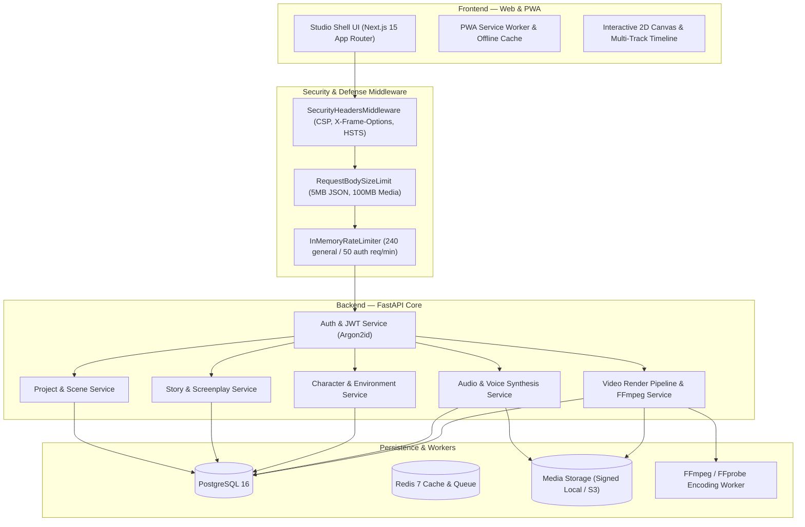

# TR STUDIO

> **Imagine Anything. Create Everything.**  
> Professional AI-Powered Animated Story Creation & Production Platform  
> **Milestones 1–10 Complete & Production Hardened**

---

## 1. Project Overview & Complete Milestones

**TR STUDIO** is an end-to-end creative suite designed to transform an initial story concept into a fully finished, scored, animated, and exported video.

### Completed Milestone Architecture

| Milestone | Capability & Status | Key Routes / Packages |
| :--- | :--- | :--- |
| **Step 1 — Foundation & Security** | Next.js 15, FastAPI, PostgreSQL, Redis, Argon2id, JWT auth, tenant isolation. | `/login`, `/register`, `/dashboard`, `/projects` |
| **Step 2 — AI Story Engine** | 12-part story wizard, 3-act plot, screenplay editor, character sheets, relational storage. | `/studio/new`, `/studio/[projectId]/story`, `/screenplay` |
| **Step 3 — Character Studio** | Canonical character bible, prompts, expression/pose/outfit variations, signed media. | `/characters`, `/characters/new`, `/characters/[id]` |
| **Step 4 — Environment Studio** | 2D world hierarchy, lighting/weather/time variations, environment asset manager. | `/environments`, `/environments/new`, `/environments/[id]` |
| **Step 5 — Scene Builder & Storyboard** | Scene composition, character/environment assignments, shot lists, storyboard overview. | `/studio/[projectId]/scenes`, `/storyboard`, `/shot-list` |
| **Step 6 — 2D Animation Engine** | Deterministic keyframing, property interpolation, easing, motion paths, canvas renderer. | `packages/animation-engine`, `/studio/[projectId]/animation` |
| **Step 7 — Multi-Track Timeline** | Multi-track sequencer, keyframe editing, clip trimming, lock/mute, zoom/pan ruler. | `/studio/[projectId]/animation` (Timeline Workspace) |
| **Step 8 — Audio & Voice Studio** | Dialogue lines, voice assignment, speech generation, narration, music, subtitles (SRT/VTT). | `/studio/[projectId]/audio` (`dialogue`, `voice`, `assets`) |
| **Step 9 — Video Render Pipeline** | True frame-by-frame evaluator, audio mix, FFmpeg encoding (H.264/AAC MP4), FFprobe probe. | `/studio/[projectId]/render`, `/studio/[projectId]/exports` |
| **Step 10 — Hardening & Launch Readiness** | Security middleware (CSP, rate limiter, body limits), touch gestures, PWA offline shell. | PWA manifest, service worker, non-root Docker, CI pipeline |

---

## 2. System Architecture



---

## 3. Quickstart & Local Development

### Prerequisites
- Node.js `22.x+` & npm `10.x+`
- Python `3.13+`
- PostgreSQL `16+`
- Redis `7+`
- FFmpeg `6.0+` (`ffmpeg` and `ffprobe` in PATH)

### 1. Environment Setup

```bash
# Clone and enter workspace
git clone <repo-url> tr-studio
cd tr-studio

# Copy environment configuration
cp .env.example .env
```

### 2. Backend Setup

```bash
cd backend
python3 -m venv .venv
source .venv/bin/activate
pip install -r requirements.txt

# Run migrations
alembic upgrade head

# Start backend server
uvicorn app.main:app --host 0.0.0.0 --port 8000 --reload
```

### 3. Frontend Setup

```bash
# From workspace root
npm install

# Start Next.js development server
npm --workspace=@tr-studio/web run dev
```

Visit `http://localhost:3000` in your browser.

---

## 4. Docker Deployment

TR STUDIO provides production-hardened Dockerfiles with non-root system users (`appuser` / `nextjs`) and health checks:

```bash
# Start complete stack with Docker Compose
docker compose up --build -d

# Check service health
docker compose ps
curl -f http://localhost:8000/health
```

---

## 5. Verification & Testing

TR STUDIO maintains comprehensive automated regression test suites across backend and frontend packages:

```bash
# 1. Run all Backend Pytest Suites (44 tests)
cd backend && .venv/bin/pytest -v

# 2. Run Animation Engine Package Tests (31 tests)
node --experimental-strip-types --test packages/animation-engine/tests/engine.test.ts

# 3. Monorepo TypeScript Typecheck
npm run typecheck

# 4. Next.js Production Build
npm run build:web

# 5. Database Backup Verification
./scripts/backup-db.sh ./backups
```

---

## 6. Documentation Index

- [Security Policy & Threat Model](file:///Users/tukaramgore/Documents/anime%20story%20tool%20/tr-studio/docs/SECURITY.md)
- [Backup & Disaster Recovery Guide](file:///Users/tukaramgore/Documents/anime%20story%20tool%20/tr-studio/docs/BACKUP_AND_RESTORE.md)
- [Step 9 Video Render Pipeline](file:///Users/tukaramgore/Documents/anime%20story%20tool%20/tr-studio/apps/web/src/components/studio/export-studio.tsx)
- [Multi-Track Timeline Editor](file:///Users/tukaramgore/Documents/anime%20story%20tool%20/tr-studio/apps/web/src/components/studio/animation-timeline.tsx)
